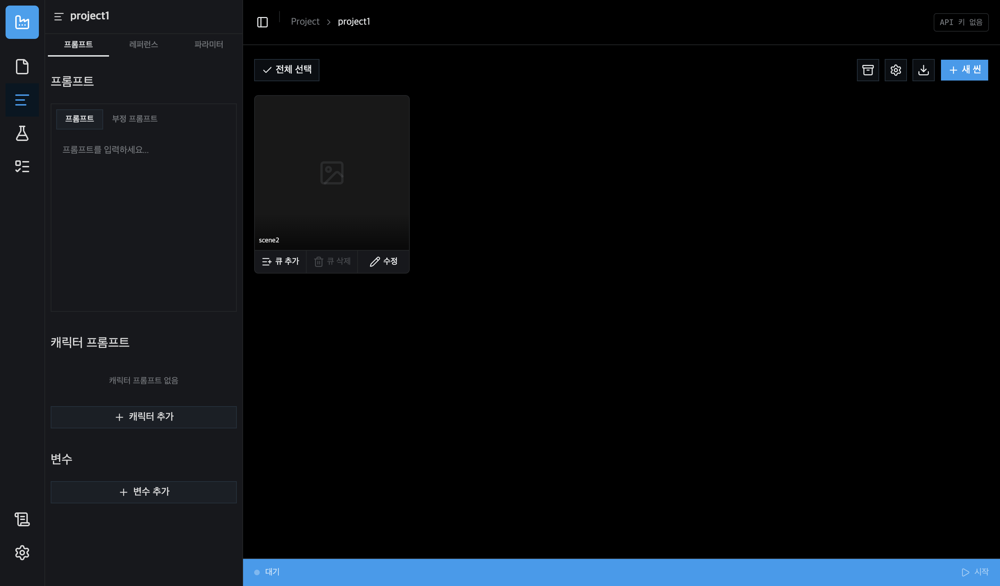

# NAI Factory

A local web app for organizing NovelAI image generation around projects, scenes, and queues.

> This is not an official NovelAI application.



## Installation

You need Docker and a NovelAI account with image generation access.

### Docker

```sh
docker run -d --name nai-factory \
  -p 127.0.0.1:3000:3000 \
  -v nai_factory_data:/app/server/data \
  --restart unless-stopped \
  ghcr.io/mokyabun/nai-factory:release
```

### Docker Compose

```sh
docker compose up -d --build
docker compose down       # stop (add -v to also delete the saved data)
```

Open <http://localhost:3000>, go to **Settings**, and enter your NovelAI API key.

## Features

- **Queue**: image count per action, with a confirmation before large batches
- **Models**: NovelAI Diffusion V5 (Full, Curated), V4.5, and V4
- **References**: character reference and vibe transfer, with cached vibe images
- **Playground**: quick one-off generations
- **Local storage**: SQLite database, images, and thumbnails on your machine

> V5 does not yet support Variety+, Vibe Transfer, or Character Reference. Those settings are
> kept when you switch models, but V5 generations ignore them.

## Documentation

- [Configuration](docs/configuration.md): environment variables and encryption
- [Data folder](docs/data-folder.md): stored files, backups, and trash
- [Security](docs/security.md): defaults and sharing on your LAN
- [Architecture](docs/architecture.md): how the code is organized

## Development

See [docs/development.md](docs/development.md) for running from source, testing, and database
migrations.
